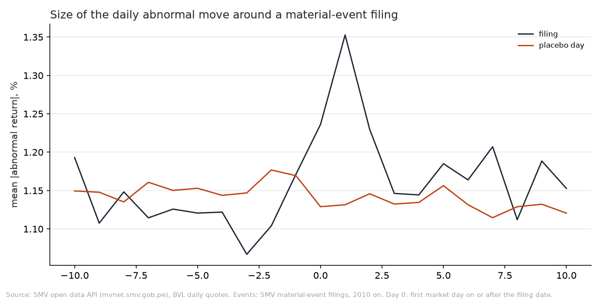
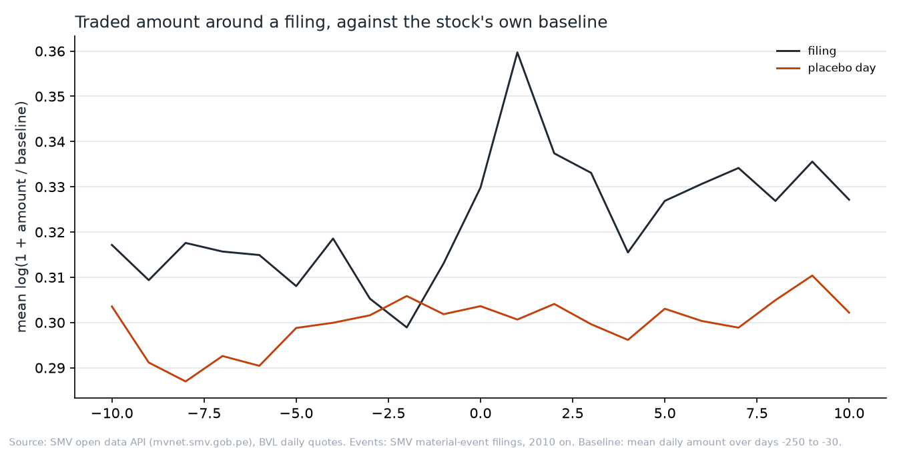
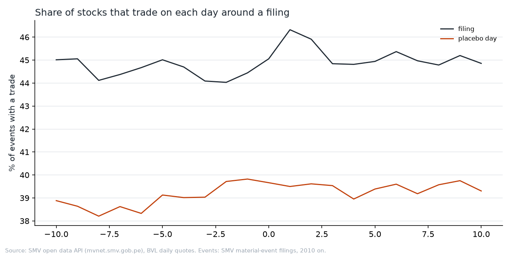
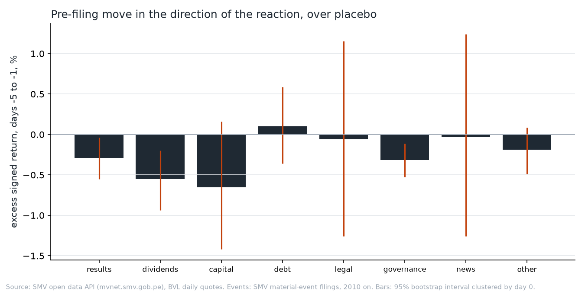
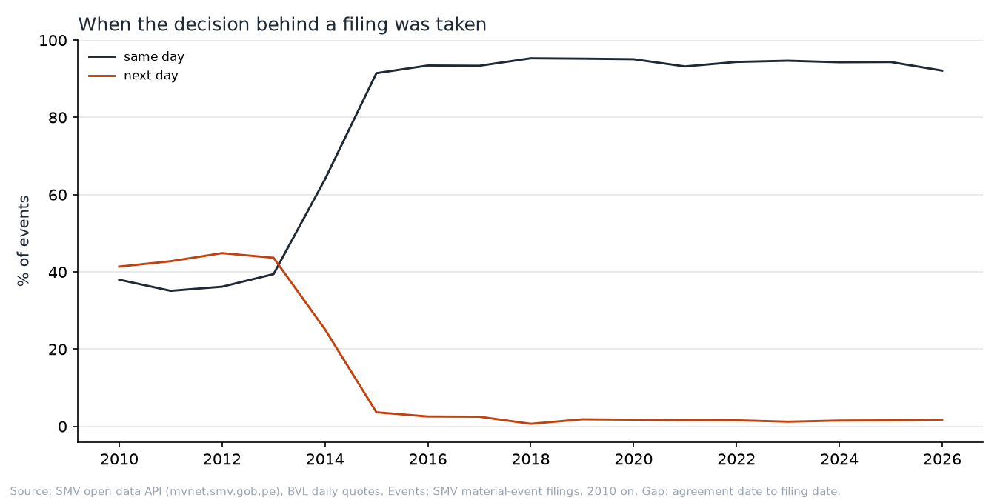

# Do BVL prices move before a material event is filed?

A Peruvian issuer must file each material event (hecho de importancia) with the
SMV. If news leaks before the filing, the stock should move before the filing in
the direction it moves on the filing day. This study tests that on every filing
made since 2010.

The data are the BVL daily quotes and the SMV's material-event register:
125,068 filings from 2010-01-04 to 2026-11-13. 13,906 events of 147 issuers
and 171 tickers can be measured. Every number below is in
[`numbers.json`](numbers.json), which `bvl study disclosure` rewrites.

## Method

- **Events.** Quotes name a ticker's company and filings carry the issuer's
  RUC. The two are matched by name, with a list of overrides for renamed
  issuers. An issuer with several share classes is measured on its most-traded
  ticker. Filings that share a day 0 are one event, and that event carries each
  of their topics. An event is kept only when its issuer filed nothing in the
  10 market days before it, so that the pre-event window is not another event's
  reaction.
- **Day 0** is the first market day on or after the filing date. The register
  gives the filing minute. A filing made during a session counts its own day as
  day 0, so a same-day reaction never falls in the pre-event window.
- **Windows** are days −5 to −1 and day −1 before the filing, and days 0 to 1
  for the reaction.
- **Abnormal return** is the stock's log price change across a window less the
  change in an equal-weighted market index of local shares.
- **Traded amount** is the window's mean daily amount over the stock's own mean
  on days −250 to −30, averaged as log(1 + ratio). Comparing a stock only with
  itself removes the currency, which the quotes do not report. An event needs
  10 trades in that baseline.
- **Placebo days** are 20 days of the same stock for each event. Each is at
  least 15 market days from any filing of the issuer and within 250 market days
  of the event. The answer is always the event value less the placebo value.
- **Intervals** are 95% bootstrap intervals that resample event days, since
  many issuers file on the same deadline day. A group needs 30 events.

The leak test is the **signed pre-event return**: the return on days −5 to −1,
multiplied by the sign of the day 0 to 1 reaction. A leak makes it positive.

## Findings

**Filings move prices.** The mean absolute abnormal return on days 0 to 1 is
2.03% after a filing and 1.76% on a placebo day: +0.28 points
[0.17, 0.41]. The peak is on day 1, not day 0, which fits a market where many
filings arrive after the session or where a thin stock trades a day late.



**Prices do not move ahead of the news.** On placebo days the signed return is
+0.16%: thin stocks trade on stale prices, so a five-day move tends to continue
into the next two days. Before a filing it is −0.04%. The excess is −0.20 points
[−0.37, −0.04], and on day −1 alone it is −0.11 [−0.23, −0.02]. The
pre-filing move runs against the reaction more often than a placebo would
predict. A leak would push it the other way. The size of the pre-filing move
is also no larger than on placebo days: −0.15 points [−0.29, −0.00] over days
−5 to −1, and 0.00 [−0.09, +0.12] on day −1.

**Traded amounts do not rise before a filing either.** Over days −5 to −1 the
excess is −0.005 [−0.024, +0.015] in log(1 + ratio). On days 0 to 1 it is
+0.051 [+0.032, +0.069].



**Stocks with filings trade more often throughout, not only before them.** A
stock trades on 44% of days −5 to −1 before a filing and 39% of placebo days,
+5.1 points [4.3, 5.9]. The figure shows this gap already at day −10. Weeks
around a filing are busier than the quiet weeks the placebos are drawn from, so
this gap is not a pre-filing build-up.



**By topic**, the excess in each measure:

| Topic      | Events | Reaction, days 0 to 1 | Signed, days −5 to −1 | Amount, days −5 to −1   |
| ---------- | -----: | --------------------- | --------------------- | ----------------------- |
| results    |  4,958 | +0.52 [+0.27, +0.83]  | −0.29 [−0.55, −0.04]  | −0.047 [−0.078, −0.019] |
| dividends  |  1,006 | +0.59 [+0.30, +0.93]  | −0.55 [−0.94, −0.20]  | −0.020 [−0.077, +0.039] |
| capital    |    425 | −0.04 [−0.41, +0.37]  | −0.65 [−1.42, +0.16]  | +0.084 [−0.043, +0.224] |
| debt       |    406 | +0.14 [−0.14, +0.46]  | +0.10 [−0.36, +0.59]  | −0.052 [−0.128, +0.024] |
| legal      |    140 | +0.19 [−0.43, +0.97]  | −0.06 [−1.26, +1.15]  | +0.062 [−0.063, +0.180] |
| governance |  3,616 | +0.27 [+0.13, +0.42]  | −0.32 [−0.52, −0.11]  | +0.027 [−0.008, +0.061] |
| news       |    129 | +0.60 [−0.21, +1.49]  | −0.03 [−1.26, +1.24]  | +0.065 [−0.106, +0.240] |
| other      |  5,350 | +0.26 [+0.06, +0.52]  | −0.19 [−0.49, +0.09]  | +0.019 [−0.011, +0.048] |

Returns are in percentage points. An event with several topics counts in each.
Results and dividends move prices most. Results draw less trading than usual in
the week before. No topic shows a positive signed return whose interval
excludes zero. Capital events (issues, buybacks, mergers) have the largest
pre-filing amount, +0.084, but its interval includes zero.



**By period**, the reaction grew: +0.20 points [0.06, 0.35] in 2010-14, +0.29
[0.05, 0.59] in 2015-19 and +0.36 [0.21, 0.53] in 2020-26. The signed
pre-event return is negative in all three. Its interval excludes zero only in
2020-26: −0.32 [−0.56, −0.09].

**Since July 2014 almost every filing is made on the day of the decision.**
Each filing records the date the decision behind it was taken. From 2010 to
2013, 35% to 39% of events were filed that day and 41% to 45% the next day.
In 2014, 64% were filed the same day. From 2015 on, 91% to 95% were, and fewer
than 4% the next day. The SMV's Reglamento de Hechos de Importancia
(Resolución SMV 005-2014-SMV/01, in force from 1 July 2014) requires a filing
"tan pronto como tal hecho ocurra ... y en ningún caso más allá del día en que
este haya ocurrido o haya sido conocido" (article 9.1).



Same-day filings carry the whole effect: a reaction of +0.34 [0.21, 0.48] and a
signed return of −0.30 [−0.50, −0.12] over 10,782 events. Filings one day or
more after the decision show no reaction whose interval excludes zero: +0.07
[−0.12, +0.25] for next-day filings (1,869 events). The pre-filing window of a
late filing already contains the decision, so a leak would show there first.
The signed return of next-day filings is +0.13 [−0.27, +0.47], which does not
separate from zero.

## What this does not show

- **Daily data cannot see a leak within the day.** A filing made at 15:00 that
  traders knew of at 10:00 looks like a clean day-0 reaction here.
- **The placebo signed return is not zero.** Stale prices carry a move into the
  next days, so the signed return is compared with the same stock's placebo
  days, not with zero. A different placebo rule would shift the baseline.
- **The market index drifts up slightly.** Trades alternate between bid and ask,
  which an equal-weighted index of thin stocks turns into a small upward drift.
  Over a two-day window it is negligible.
- **Ticker matching is by name.** Issuers renamed without an override are lost,
  and an issuer whose name matches no ticker contributes nothing.
- **Many tests.** The table has 24 intervals. At 95%, about one may exclude
  zero by chance. The overall and same-day results rest on thousands of events;
  a single topic cell does not.
- **Only clean events.** An issuer that files often (a bank, a utility) loses
  many events to the 10-day rule. The results describe isolated filings.
- **Amounts are in an unreported currency.** Each stock is compared with its own
  baseline, so this does not bias a ratio. It does rule out market-wide sums.

## Rerun

```bash
uv run bvl fetch quotes
uv run bvl fetch events
uv run bvl study disclosure
```

[The bvl manual](../../docs/BVL.md) describes the data and the commands.
