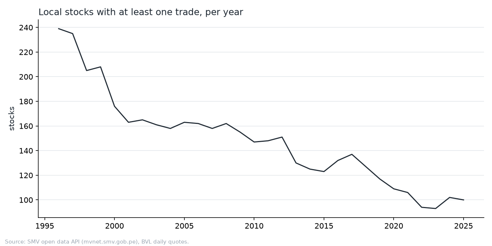
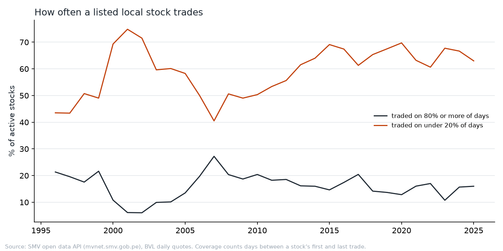
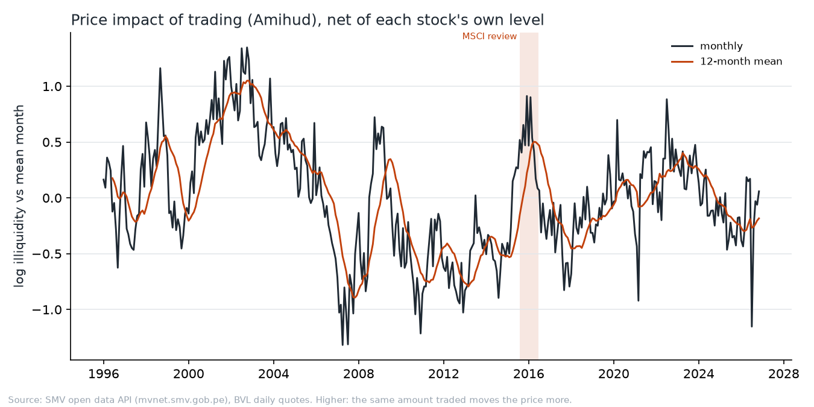
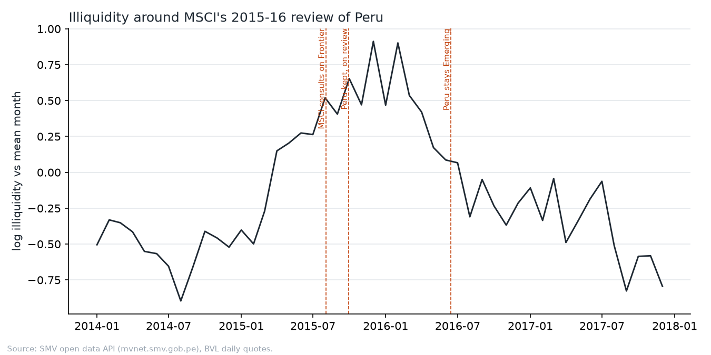

# BVL liquidity since 1996

How easy has it been to trade a Peruvian stock on the Lima Stock Exchange
(BVL), and did liquidity fall during MSCI's 2015-16 review of Peru's Emerging
Markets status?

The data are the BVL daily quotes the SMV publishes, 1996-01-02 to 2026-11-13:
619 local share tickers and 19,029 stock months with an illiquidity ratio. Every
number below is in [`numbers.json`](numbers.json), which `bvl study liquidity`
rewrites.

## Method

The quotes report a traded amount without its currency, and BVL stocks trade in
soles or US dollars. A sum across stocks would add the two. Each measure here
compares a stock only with itself, or counts stocks and days:

- **Active stocks:** local stocks with at least one trade in the year.
- **Coverage:** the share of market days a stock traded, counted between its
  first and last trade, so a listing or a delisting does not count as idle days.
- **Illiquidity:** the Amihud ratio, |daily log return| / traded amount,
  averaged per stock and month over months with 5 or more traded days. A
  currency multiplies a stock's ratio by a constant, so a two-way fixed-effects
  model of the log ratio (stock + month) removes it. The month effects that
  remain trace the market, relative to the mean month.

A local share is a ticker of the BVL form (`ALICORC1`: letters, a class letter,
a series digit) whose name does not say fund or ETF. Foreign listings such as
`BAP` or `AMD` are left out.

## Findings

**Fewer stocks trade, and most trade rarely.** 239 local stocks traded in 1996,
147 in 2010 and 100 in 2025. In every year since 2000 the median active stock
traded on less than a third of market days; in 2020 it traded on 5%. The share
that traded on 80% or more of days has stayed between 6% and 27%.





**Illiquidity peaked in 2001-03 and again in 2015-16.** The yearly effects run
from −0.86 (2007, the most liquid year) to +1.03 (2002). After the 2007 boom,
2010-14 sat between −0.46 and −0.72.



**The 2015-16 rise started before MSCI's consultation.** Mean monthly log
illiquidity was −0.27 from August 2014 to July 2015, +0.50 during the review
(August 2015 to June 2016) and −0.22 in the year after Peru kept its status.
The difference of 0.77 log points means the same traded amount moved prices
about 2.2 times as much during the review. The rise began in March 2015, five
months before MSCI opened the consultation, and fell back from March 2016, three
months before the decision.



## What this does not show

- **It does not isolate MSCI.** 2015 also had the end of the commodity boom, a
  falling sol and outflows from emerging markets. The timing fits a market that
  priced the downgrade risk early, and it fits those other causes as well. A
  control market (Chile, Colombia) would separate them; the SMV has no data on
  other markets.
- **Amounts are nominal.** Peruvian inflation raises the nominal amount that
  trades for the same real value, so it pulls the illiquidity effects down by a
  few percent a year. That does not move a one-year comparison much. A
  thirty-year trend in the effects would be partly inflation.
- **No split factors.** A move larger than log 2 in one day is dropped as an
  unrecorded split or data error. A smaller stock dividend stays in the data as
  a loss on its ex date.
- **2026 is a partial year**, and a single month (July 2026) has a large
  negative effect that a few trades can produce.

## Rerun

```bash
uv run bvl fetch quotes
uv run bvl study liquidity
```

[The bvl manual](../../docs/BVL.md) describes the data and the commands.
